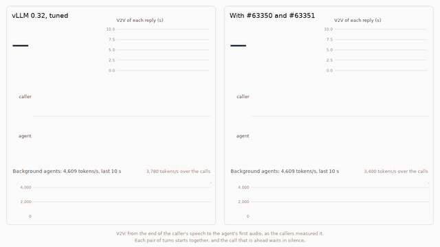

# Leaseholder

[](https://github.com/StevenWang-CY/leaseholder/actions/workflows/ci.yml)

**A voice agent and coding agents on one GPU.** A self-hosted voice agent (speech to text, an LLM, text to speech) needs
its GPU for a fraction of each turn, and background work such as coding agents could use the rest. On vLLM 0.32, beside
24 long-context coding-agent sessions on one RTX 5060 Ti, the voice agent's p95 response goes from 1.78 s to 10.5 s. The
time is lost inside vLLM's scheduler: a waiting voice turn cannot take KV cache from running agent requests, and once it
runs, their prefill shares every step of its reply. Two changes to the scheduler, proposed upstream as
[#63350](https://github.com/vllm-project/vllm/pull/63350) and [#63351](https://github.com/vllm-project/vllm/pull/63351),
bring it to 2.24 s, 0.20 s over its SLO, while the agents keep 97% of their throughput.



*The same caller's second turn on each engine, beside the same agents (recorded 2026-10-25): the two PRs answer after
1.9 s, tuned vLLM after 9.6 s; over both calls of each run, their V2V p95 was 2.2 and 11.2 s. The 170-second video, with
sound, is in the [v1.0 release](https://github.com/StevenWang-CY/leaseholder/releases/tag/v1.0).*


| Two calls beside 24 coding-agent sessions that fill the KV pool | Voice p95 | Over the SLO | Agents' tokens/s | Agents' TTFT p50 |
|---|---:|---:|---:|---:|
| Voice alone, the SLO's reference | 1,784 ms | — | — | — |
| vLLM 0.32, tuned: priority scheduling, a 512-token step cap, a CPU KV tier | 10,477 ms | +8,443 ms | 3,305 | 63 s |
| Tuned, with a router that aborts agent requests before their first byte and resubmits them | 2,522 ms | +488 ms | 3,332 | 32 s |
| + #63350: a waiting request preempts lower-priority work for KV | 5,085 ms | +3,051 ms | 3,414 | 67 s |
| + #63351: agent prefill sits out the reply's first 16 tokens | 3,094 ms | +1,060 ms | 3,298 | 71 s |
| + #63351 with a 48-token window: **the configuration to deploy** | **2,236 ms** | +202 ms | 3,203 | 72 s |

Medians of five rounds (10 runs for tuned vLLM and 15 for the last row, which more than one campaign ran), each round on
its own sample of the agents' traces with every configuration in a rotated order. The SLO is voice alone plus 250 ms at
p95. The PRs' rows ran as Leaseholder's make-room variant on vLLM 0.32.0 with the PRs' switch values, which schedules as
the PRs' diff, ported to 0.32.0, did before their revision of 2026-10-25; that revision ends the window's hold a step
sooner, a step only replies at least the window long reach ([after
W5](docs/BENCHMARKS.md#after-w5-the-first-tokens-in-flight)). The agents' tokens/s count the first 240 s of the calls.
These agents wait about a minute for a first token: the regime this change is for ([is
yours?](docs/PRODUCTION.md#is-your-deployment-in-this-regime)). On the final code, five more rounds on W5's own samples
gave the last row 2.27 s, round by round −45 to +77 ms from W5's ([FB](benchmarks/results/2026-10-25-e2-fb)). Every run
and range is in [BENCHMARKS.md](docs/BENCHMARKS.md#voice-under-agent-load-e2).

## What it shows

1. **vLLM cannot preempt for a waiting request.** Its scheduler serves running requests first and preempts only so that
   one of them can grow; the waiting loop stops at the first request it cannot allocate. Behind two 18k-token agent
   requests in a full pool, a 750-token voice turn waits 4.9–5.0 s for its first token, and 219–290 ms with #63350 ([the
   KV case](docs/BENCHMARKS.md#the-kv-case-make-room)).
2. **Getting the turn into the batch is not enough.** A step cap bounds tokens, not time. Beside three agent prefills
   the reply's tokens come 60–65 ms apart with #63350 alone and 16–20 ms apart with #63351, and #63350 alone leaves the
   voice p95 at 5.1 s.
3. **The window must cover the reply's first sentence**, because the voice agent hands TTS its first complete sentence,
   not its first token. This agent's replies run 23 tokens at the median and 52 at most: a 16-token window leaves 3.1 s,
   48 tokens 2.24 s.
4. **A control plane in front can make room only by aborting work.** A gateway can hold back new requests and abort
   admitted ones; only the engine can take KV from a request already decoding. Aborting and resubmitting agent requests
   reaches 2.52 s at the agents' cost (TTFT p99 193 s against 106 s); the lifecycle policy, timed by the conversation,
   never found its headroom and left tuned vLLM at 11.0 s (W4) ([what it could not
   do](docs/METHODS.md#what-lifecycle-timing-could-and-could-not-do)).

## Where it falls short, and what it costs

- **A pool with room.** At a realistic load of the whole corpus (16 sessions), where the pool has room, #63350 has
  little to do (0–7 preemptions a run) and the cap holds agent prefill in 3–13% of the steps. The PRs' p95 was the lower
  in every one of five rounds, by 109–1,413 ms, but met the SLO in only one: 2,021–2,419 ms against tuned vLLM's
  2,147–3,832 ms.
- **Many calls.** #63351 holds agent prefill while any call's first tokens are due, so overlapping replies hold it for
  longer: with 4 and 6 callers the PRs' p95 was 0.27 s and 0.26 s over each one's SLO in every round, against 0.20 s
  with two ([how it fails](docs/PRODUCTION.md#how-it-fails)).
- **The agents pay through the prefill hold.** Their TTFT p50 rises by 9 s, from 63 to 72 s, and the cap holds their
  prefill in 33% of the engine's steps during the calls; the preemptions cost no measurable throughput. What a preempted
  request recomputes when it resumes, no vLLM 0.32 counter shows
  ([E3](docs/BENCHMARKS.md#e3-what-make-room-takes-from-the-agents)).
- **Other GPUs.** The mechanisms are not specific to the card; what each costs is. On an A100 40 GB with the box's pool,
  `lh-sim` forecasts the KV case's first token at 1.6–1.7 s on stock vLLM and 134–158 ms with #63350 ([the
  forecast](benchmarks/a100/forecast.md), written before the run that checks it, [docs/HARDWARE.md](docs/HARDWARE.md));
  other cards are placed by the same model ([what transfers](docs/METHODS.md#what-transfers-to-other-hardware)).

## Try it on vLLM 0.32

The make-room variant builds vLLM 0.32.0's scheduler with the two PRs, backported, from an installed vLLM, without
modifying it:

```sh
python python/leaseholder_vllm/src/leaseholder_vllm/build.py make-room ~/make-room
PYTHONPATH=~/make-room vllm serve Qwen/Qwen3-4B-Instruct-2507-FP8 \
  --scheduling-policy priority --max-num-batched-tokens 512 --long-prefill-token-threshold 256 \
  --scheduler-cls lh_make_room_scheduler.AsyncScheduler \
  --additional-config.make_room.max_preemptions_per_step 2 \
  --additional-config.make_room.budget_cap true --additional-config.make_room.budget_cap_tokens 48 \
  --additional-config.make_room.reserve_tokens 0
python python/leaseholder_vllm/src/leaseholder_vllm/make-room/probe.py http://127.0.0.1:8000 kv   # a voice turn behind two long agent requests
```

Send `priority` with each request, 0 for voice and 2 for background work, and add the CPU KV tier from
[`engine.yaml`](deploy/phastform/engine.yaml). `probe.py` sizes its requests from the engine's pool and context, so the
check runs as it is on another card.

[docs/PRODUCTION.md](docs/PRODUCTION.md) has the whole configuration (the CPU tier, the priorities, what to watch, how
it fails) and how to check it on your hardware.

## How it was measured

- **The box.** One RTX 5060 Ti 16 GB runs vLLM 0.32 with Qwen3-4B-Instruct-2507-FP8 and a 36,400-token KV pool, Whisper
  and Kokoro on the same GPU, a 20 GiB CPU KV tier, NUMA-pinned units.
- **Voice-to-voice from waveforms.** Two LiveKit callers speak scripted lines, synthesized in six voices, to a stock
  LiveKit voice agent and time the end of their speech to the agent's first audio; the agent logs each turn's stages.
- **The agents.** AIPerf replays the 48 longest-context Claude Code sessions of SemiAnalysis' traces, block-scaled 32×,
  with their think times, through the gateway at a lower priority.
- **Rounds.** Every configuration runs in each round, in a rotated order, on the round's own sample of the agents; a
  call opens with an unmeasured warm-up turn. Baselines are configured as their authors recommend.
- **Reproducible.** `make reproduce-e2` rebuilds every table and figure from the committed records; the gateway adds
  0.29 ms to a voice request's first token, paired against the engine's own socket on the final transport
  ([W6](docs/BENCHMARKS.md#the-control-plane-lh-gateway-in-front-of-the-engine)).

## Documentation

| To | Read |
|---|---|
| read the work as one paper: the problem, the change, the results and their limits | [docs/REPORT.md](docs/REPORT.md), the technical report |
| deploy the change and watch it | [docs/PRODUCTION.md](docs/PRODUCTION.md) |
| see how it works in vLLM's scheduler | [docs/ARCHITECTURE.md §2](docs/ARCHITECTURE.md#2-the-change-63350-and-63351), then the two PR diffs |
| see every number, with runs and ranges | [docs/BENCHMARKS.md](docs/BENCHMARKS.md) |
| know how each experiment was designed and run | [docs/EXPERIMENTS.md](docs/EXPERIMENTS.md) |
| follow the method: what was measured, in what order, and why | [docs/METHODS.md](docs/METHODS.md) |
| compare with llm-d, Dynamo, SMG, SGLang and papers | [docs/PRIOR-ART.md](docs/PRIOR-ART.md) |
| know why a decision was made | [docs/adr/](docs/adr) |
| look up a term (arm 9, the frozen box, the window, W0 to W8) | [docs/GLOSSARY.md](docs/GLOSSARY.md) |
| run it on other hardware, or on one host | [docs/HARDWARE.md](docs/HARDWARE.md) |
| operate the hosts, and what the failure drills showed | [ops/RUNBOOK.md](ops/RUNBOOK.md) |

## Why not llm-d, Dynamo, SMG or vllm-project/router?

They act in front of the engine, and the voice turn loses its time inside the engine's scheduler. E2 measured SMG,
llm-d's flow control (emulated), and vLLM's and SGLang's own priority preemption: none meets the SLO, and most leave the
p95 between 8.8 and 12.1 s. What this adds is the change to vLLM's scheduler (SGLang's counterpart is its own draft,
#45686), the end-to-end measurement against every deployable alternative, and two measured negatives: a gateway policy
timed by the conversation (E2) and agent-side KV prefetch (E1). `lh-gateway` is a small Rust harness for these
experiments, not a fleet router. [docs/PRIOR-ART.md](docs/PRIOR-ART.md) has the sources and where each result went
upstream.

## Repository

```text
crates/lh-proto/          wire types and their JSON Schemas
crates/lh-core/           cost and step-time models, KV geometry, the admission policies E2 compares
crates/lh-gateway/        the gateway that sets priorities and runs E2's admission policies
crates/lh-sim/            the KV cache simulator behind E1
python/leaseholder_vllm/  the change on vLLM 0.32: the PRs as patches, the build, probes and tests
python/leaseholder_bench/ the E2 harness, trace conversion, probes and drills
python/leaseholder_voice/ the voice agent and the measurement callers
python/leaseholder_stats/ the statistics the measurements publish, each defined once
benchmarks/               E2's arm files and campaigns, the committed records, and the A100 run
deploy/                   per-host bootstrap, hardware profiles, systemd units, the engine variants' drop-ins, tunnels,
                          single-host mode
ops/                      the runbook, the failure drills, Prometheus rules and a Grafana dashboard
docs/                     the documents above, ADRs and figures
```

## Development

Rust 1.98, uv and Python 3.12; no GPU.

```sh
make check                           # lint and the tests of CI's main job
make test-make-room-ci               # CI's make-room job (Linux x86-64): the change's behavior suite and its trace
                                     # against the PRs' patches, on vLLM's real scheduler
make perf-make-room TORCH_PYTHON=PY  # the change's cost a scheduler step on CPU, its switches off against stock vLLM
                                     # and on against off, against peacock's baseline (PY: an absolute path)
make compat-upstream                 # the PRs against vLLM's main, make-room's patches against vLLM's newest release
make reproduce-e2                    # E2's tables and figures from the committed records (W4)
make reproduce-e2-w5                 # the same for W5's records
make reproduce-e1 CORPUS=DIR         # E1's tables with lh-sim, from the 32x corpus
make forecast-a100 CORPUS=DIR        # lh-sim's forecast for the A100 run, benchmarks/a100/forecast.md
```

The name is the original design's, in which the gateway held leases on sessions' KV; E1 and E2 showed the engine had to
carry the realtime tier, and that design was dropped
([ADR-0006](docs/adr/0006-the-engine-change-carries-the-realtime-tier.md)).

## License

Apache-2.0
